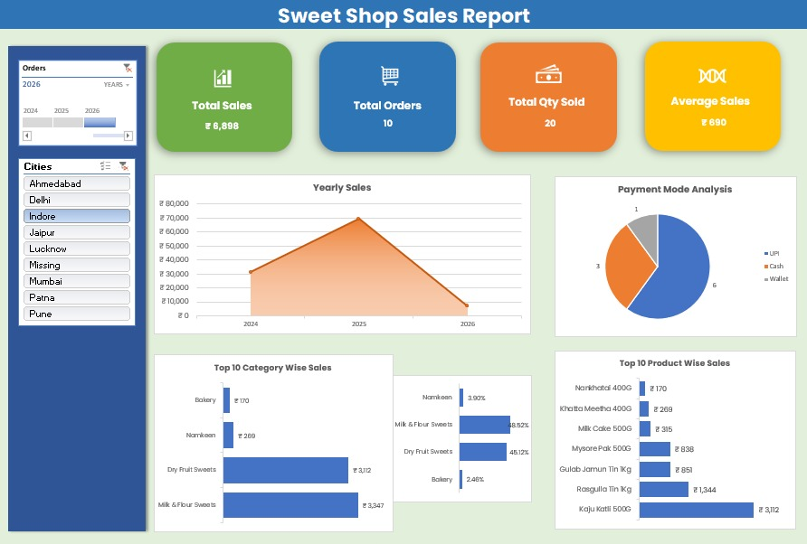

# Sweet Shop Sales Analysis & MIS Dashboard

## Project Overview
An Excel-based MIS project focused on cleaning, validating and analysing sweet shop sales data to identify business insights and present them through an interactive dashboard.

## Preview

## Tools Used
- Microsoft Excel 2021
- PivotTables & PivotCharts
- Excel Formulas
- Slicers

## Data Cleaning & Validation
- Removing duplicate data.
- Standardized inconsistent text values and corrected data formats.
- Identified and handled missing values.
- Created a Data Quality Report and Data Quality Log.
- Validated sales calculations and identified discrepancies.

## Analysis & Key Findings

Analysed sales by category, city, product, payment mode and time period.

Key findings:
- Gift Boxes generated the highest category-wise sales.
- Mumbai recorded the highest city-wise sales.
- UPI was the most frequently used payment mode.

## Dashboard KPIs
- Total Sales
- Total Orders
- Total Quantity Sold
- Average Sale

## Objective
To gain practical experience in data cleaning, data validation, sales analysis and MIS reporting using Microsoft Excel.